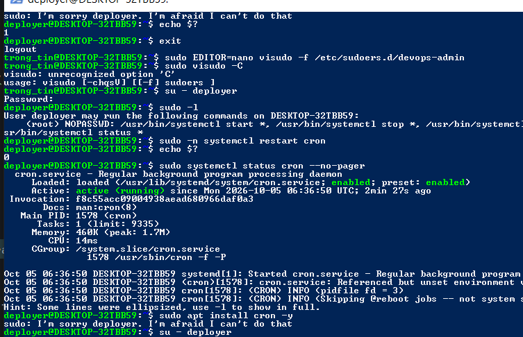

# Bài 2: Cấu hình phân quyền nhóm và sudoers bằng visudo

## 1. Môi trường
- Ubuntu 26.04.1 LTS chạy trên Windows qua WSL2.
- Tài khoản quản trị thực hành: trong_tin.
- Tài khoản được cấp quyền giới hạn: deployer.
- Nhóm được cấp quyền: devops-admin.

## 2. Tạo nhóm và người dùng

Các lệnh đã thực hiện:

```bash
sudo groupadd devops-admin
sudo adduser deployer
sudo usermod -aG devops-admin deployer
id deployer
```

Kết quả:

```text
uid=1002(deployer) gid=1002(deployer) groups=1002(deployer),100(users),1001(devops-admin)
```

## 3. Chuẩn bị dịch vụ kiểm tra

```bash
sudo apt update
sudo apt install cron nano -y
```

Kết quả: cron và nano đã được cài đặt.

## 4. Cấu hình sudoers bằng visudo

Mở file cấu hình riêng trong thư mục /etc/sudoers.d:

```bash
sudo EDITOR=nano visudo -f /etc/sudoers.d/devops-admin
```

Dòng cấu hình đã thêm:

```sudoers
%devops-admin ALL=(root) NOPASSWD: /usr/bin/systemctl start *, /usr/bin/systemctl stop *, /usr/bin/systemctl restart *, /usr/bin/systemctl status *
```

Đặt quyền cho file:

```bash
sudo chmod 440 /etc/sudoers.d/devops-admin
```

Giải thích:
- %devops-admin: áp dụng cho các thành viên của nhóm devops-admin.
- ALL: quy tắc áp dụng trên mọi máy chủ nơi cấu hình được sử dụng.
- (root): thực thi các lệnh được liệt kê với quyền root.
- NOPASSWD: không yêu cầu mật khẩu khi chạy các lệnh được cấp.
- Các mẫu lệnh cho phép thao tác start, stop, restart và status với dịch vụ.
- Không cấp quyền chạy mọi lệnh sudo cho deployer.

## 5. Kiểm tra bằng tài khoản deployer

```bash
su - deployer
whoami
```

Kết quả:

```text
deployer
```

Kiểm tra quyền:

```bash
sudo -l
```

Kết quả thực tế:

```text
User deployer may run the following commands on DESKTOP-32TBB59:
    (root) NOPASSWD: /usr/bin/systemctl start *, /usr/bin/systemctl stop *, /usr/bin/systemctl restart *, /usr/bin/systemctl status *
```

## 6. Kiểm tra restart không cần mật khẩu

```bash
sudo -n systemctl restart cron
echo $?
```

Lệnh restart không hỏi mật khẩu và không báo lỗi.
Mã thoát:

```text
0
```

Kiểm tra trạng thái:

```bash
sudo systemctl status cron --no-pager
```

Các dòng chính trong kết quả thực tế:

```text
● cron.service - Regular background program processing daemon
     Loaded: loaded (/usr/lib/systemd/system/cron.service; enabled; preset: enabled)
     Active: active (running) since Mon 2026-10-05 06:36:50 UTC; 2min 27s ago
   Main PID: 1578 (cron)
```

## 7. Kiểm tra giới hạn quyền

Khi đăng nhập bằng deployer, chạy:

```bash
sudo apt install cron -y
```

Kết quả:

```text
sudo: I'm sorry deployer. I'm afraid I can't do that
```

Lệnh bị từ chối vì apt không nằm trong danh sách được cấp quyền.

## 8. Kết luận
Đã tạo nhóm devops-admin và thêm deployer vào nhóm.
Deployer chạy được các lệnh quản lý dịch vụ đã cấp mà không cần mật khẩu.
Restart cron thành công, dịch vụ hoạt động và lệnh sudo ngoài phạm vi bị từ chối.